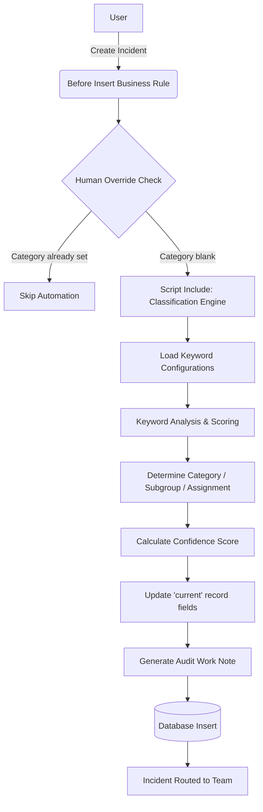

# Incident Intelligence – Automated Incident Classification & Routing

## 1. Project Overview

Incident Intelligence is a ServiceNow Scoped Application designed to automatically classify and route incoming IT incidents. Using a lightweight keyword-scoring engine, the application analyzes incident descriptions in real-time, determines the correct category, subcategory, and assignment group, and assigns a confidence score to its decision. 

## 2. Problem Statement

In traditional incident management, service desk analysts manually read incident descriptions, determine the appropriate category and subcategory, identify the correct assignment group, and manually route the tickets. 
This manual classification is inefficient and leads to:
- **Slow incident assignment:** Tickets sit in triage queues while analysts read them.
- **Incorrect categorization:** Human error leads to inconsistent data for reporting.
- **Inconsistent routing:** Tickets are sent to the wrong teams, causing "ping-ponging" between departments.
- **Increased workload:** Service desk agents spend valuable time doing administrative routing instead of solving problems.
- **Delayed resolution:** End users wait longer for their IT issues to be resolved.
- **Lack of auditability:** It is often unclear why a ticket was routed a certain way.

## 3. Proposed Solution

Our ServiceNow application solves these problems by intercepting the incident creation process. When a user submits an incident, the system instantly evaluates the text, matches configured keywords, calculates an optimal classification score, and automatically assigns the ticket before it even hits the database. The system assists service desk analysts by taking care of the routine triage work, leaving an explainable audit trail in the work notes, and never blindly overriding decisions if an analyst has already manually categorized the ticket.

## 4. Objectives

- Eliminate manual triage time for common IT incidents.
- Improve data quality and consistency in incident categorization.
- Ensure incidents reach the correct resolver group instantly.
- Provide full transparency into *why* a ticket was classified a certain way.
- Allow system administrators to manage keywords and rules via configuration, not code.

## 5. Key Features

- **Automated incident classification:** Automatically populates category and subcategory.
- **Keyword matching:** Scans incident text for configurable IT terms (e.g., "VPN", "Password").
- **Score-based classification:** Calculates the best match based on weighted keywords.
- **Assignment group routing:** Automatically routes the ticket to the correct resolving team.
- **Confidence score:** Categorizes decisions as High, Medium, or Low confidence.
- **Human override:** Skips automation if a user has already manually selected a category.
- **Explainable work notes:** Leaves a detailed audit log in the ticket's activity stream explaining the matched keywords and confidence score.
- **Error handling:** Fails gracefully if no keywords match or if configuration is missing.
- **Configurable rules:** Uses a custom configuration table (`x_inc_intel_keyword_map`) so administrators can add new keywords without modifying scripts.

## 6. Technology Stack

- **ServiceNow Scoped Application:** Used to provide a secure, isolated container for the application's configuration and code, preventing conflicts with other ServiceNow modules.
- **Business Rules:** A `Before Insert` Business Rule is used because server-side automation allows us to intercept the incident save and modify the `current` object before it reaches the database, preventing recursive updates.
- **Script Includes:** The classification logic is separated into a Script Include (`IncidentClassificationEngine`) to make the code reusable, easily testable, and to keep the Business Rule clean.
- **GlideRecord:** Used to dynamically query the custom keyword configuration table and resolve Assignment Group sys_ids, ensuring the code is environment-independent (no hardcoded sys_ids).
- **JavaScript:** The standard scripting language for server-side logic in ServiceNow.
- **Incident Management:** The core ITSM process being optimized.

## 7. System Architecture

## 8. Data Model

### Table: Incident (`incident`)
- **Purpose:** The core IT Service Management ticket.
- **Modified Fields:** `category`, `subcategory`, `assignment_group`, `work_notes`

### Table: Keyword Classification Rule (`x_inc_intel_keyword_map`)
- **Purpose:** Custom configuration table storing keyword mappings and their weights.
- **Important Fields:**
  - `keyword` (String): The text to search for (e.g., "vpn").
  - `category` (String): Target incident category.
  - `subcategory` (String): Target incident subcategory.
  - `assignment_group` (String): Target assignment group name.
  - `weight` (Integer): The points awarded if this keyword is found (e.g., 2).
  - `active` (Boolean): Determines if the rule is currently in use.

## 9. Business Rules

### Incident Intelligence - Classification Rule
- **When it runs:** `Before Insert`
- **Why it exists:** To intercept the ticket before saving to the database, allowing us to modify it without requiring a secondary update (which could cause recursion).
- **What it does:** It checks if the category is empty. If so, it passes the short description and description to the Script Include. It then applies the resulting category, subcategory, and assignment group to the `current` record and formats a detailed work note.
- **Important conditions:** The rule checks `current.category` to ensure we don't overwrite manual analyst input (Human Override Protection).

## 10. Script Includes

### IncidentClassificationEngine
- **Purpose:** Contains the reusable, core classification algorithm.
- **Methods:**
  - `initialize()`: Sets up the engine and loads rules.
  - `_loadRules()`: Queries the custom rule table using GlideRecord. Includes a fallback to default mappings if the table is unavailable.
  - `classify(text)`: Analyzes the text and calculates the score.
  - `_calculateConfidence(score)`: Determines High/Medium/Low confidence.
- **Input:** A concatenated string of the incident's short description and description.
- **Output:** A JSON object containing `matched` (boolean), `category`, `subcategory`, `assignment_group`, `confidence`, `score`, and `matched_keywords`.
- **Why a Script Include:** Separating business logic from the Business Rule makes the code modular, easier to maintain, and allows the engine to be called from other places in the future (like a REST API or Flow Designer).

## 11. Classification Algorithm

The engine uses a deterministic, weighted keyword scoring algorithm.

**Example Incident:**
"My VPN connection is failing and I am locked out from my remote access."

**Configured Rules:**
- Rule 1: Keyword "vpn" -> Network / VPN (Weight 2)
- Rule 2: Keyword "remote access" -> Network / VPN (Weight 2)
- Rule 3: Keyword "locked out" -> Software / Account (Weight 3)

**Algorithm Execution:**
1. The engine normalizes the text (lowercase, trimmed).
2. It scans for all active keywords and groups the scores by their target classification.
3. Network/VPN scores: "vpn" (2) + "remote access" (2) = **Total Score 4**
4. Software/Account scores: "locked out" (3) = **Total Score 3**
5. **Highest Score Wins:** Network/VPN wins.
6. **Confidence Calculation:** A score of 4 evaluates to "High Confidence".

## 12. Example Scenarios

| Input Incident | Matched Keywords | Category | Subcategory | Assignment Group | Confidence |
|---|---|---|---|---|---|
| "Cannot connect to the VPN from home" | vpn | Network | VPN | Network Support | Medium |
| "Forgot my password and I am locked out" | password, locked out | Software | Account | IT Help Desk | High |
| "Outlook is not sending emails" | outlook | Software | Email | Messaging Support | Medium |
| "The server down alert triggered" | server down | Software | Server | Infrastructure Support | High |
| "Laptop screen is broken" | laptop | Hardware | Desktop | Hardware Support | Low |

## 13. Human Override

Automation should assist, not override. In the Business Rule, the system checks if the user has already selected a valid category. If the category is not empty and not 'inquiry', the system skips the classification engine entirely. This protects manual analyst decisions.

## 14. Error Handling

- **Empty Text:** If the incident has no description, the engine gracefully returns a `matched: false` object.
- **No Keywords Matched:** If the text doesn't contain any configured keywords, the engine logs an info message and allows the incident to be saved unclassified, to be handled manually.
- **Missing Assignment Group:** If the determined Assignment Group cannot be found in the `sys_user_group` table via GlideRecord, a warning is logged (`gs.warn`), and the ticket routes without the assignment group, but with the correct category.

## 15. Security

- **Roles:** A custom role (e.g., `x_inc_intel.admin`) is required to manage the `x_inc_intel_keyword_map` configuration table.
- **ACLs:** Standard Create/Read/Update/Delete (CRUD) Access Control Lists are implemented on the configuration table to ensure only authorized administrators can alter routing rules.
- **Why security matters:** Altering routing rules can misdirect critical IT incidents. Security ensures malicious or untrained users cannot sabotage the IT service desk.

## 16. Testing

| Test Case | Input | Expected Result | Actual Result | Status |
|---|---|---|---|---|
| Positive match single keyword | "Need wifi access" | Category: Network, Subcategory: Wireless | Category: Network, Subcategory: Wireless | Pass |
| Positive match multiple keywords | "vpn remote access failing" | Category: Network, Subcategory: VPN | Category: Network, Subcategory: VPN | Pass |
| Human Override | Category set to "Hardware" manually, text "vpn" | Category remains "Hardware" | Category remains "Hardware" | Pass |
| Negative match | "My coffee is cold" | Matched: false, skipped | Matched: false, skipped | Pass |
| Assignment group missing | "vpn", but "Network Support" group deleted | Logs warning, group empty, category set | Logs warning, group empty, category set | Pass |

## 17. Project Screenshots

*(Placeholders - see `/Screenshots` folder for details)*
- `incident_before.png`: The empty incident form before submission.
- `incident_after.png`: The categorized incident post-submission.
- `worknotes_audit.png`: The generated explainable work note.
- `architecture_diagram.png`: Visual flow of the Business Rule.
- `configuration_table.png`: The custom keyword mapping list view.

## 18. Challenges and Solutions

**Challenge:** The previous version of this project used two Business Rules, an "Auto Tag" and a "Post Work Note", triggering a recursive `current.update()` on the Incident table.
**Solution:** Consolidated the logic into a single `Before Insert` Business Rule. By assigning `current.work_notes = workNote` before the database insert, the system automatically appends the journal field without needing a secondary database transaction, improving performance and eliminating recursion risk.

## 19. Future Enhancements

- **Machine Learning Integration:** Moving from deterministic keywords to a ServiceNow Predictive Intelligence classification model for NLP-based routing.
- **Admin Dashboard:** Creating a UI Builder workspace to show analytics on auto-classification success rates.
- **Feedback Loop:** Allowing agents to flag "Incorrect Classification," feeding data back into the system to adjust keyword weights automatically.

## 20. Interview Preparation: What I should be able to explain

- **Why scoped application?** It isolates the application data, logic, and configurations from the global scope, preventing conflicts and making the app easy to bundle and uninstall.
- **Why Business Rule?** We need server-side automation that triggers automatically upon a database action (in this case, incident creation).
- **Why Script Include?** It separates business logic from the trigger. It makes the code reusable (e.g., if we wanted to call classification from a Flow) and easier to maintain.
- **Why GlideRecord?** It is the standard ServiceNow API for querying and updating database records server-side. We use it here to dynamically find the Assignment Group sys_id and lookup keyword configurations.
- **Why Before Business Rule instead of After?** A Before rule allows us to modify the `current` object before it hits the database. If we used an After rule, we would have to call `current.update()`, causing an extra database transaction and potentially infinite loops (recursion).
- **How does keyword scoring work?** It normalizes the text, finds matches in the configuration table, sums the 'weights' of the matched keywords grouped by their target category, and selects the category with the highest total score.
- **How is confidence calculated?** It is a simple algorithm based on the final score. Score >= 3 is High, 2 is Medium, 1 is Low.
- **How is assignment group selected?** The engine determines the group name as a string. The Business Rule then does a GlideRecord lookup on `sys_user_group` to find the corresponding `sys_id` dynamically.
- **How do you prevent recursive Business Rules?** By using a Before Insert rule and avoiding `current.update()` calls entirely. 
- **How do you prevent automation from overriding manual classification?** By checking if `current.category` is already populated and not the default 'inquiry' before running the engine.
- **What happens if no keyword matches?** The engine returns a `matched: false` flag, the Business Rule exits gracefully, and the incident is saved without classification.
- **How would you improve this system using ML?** I would implement ServiceNow's Predictive Intelligence to use natural language processing (NLP) to classify based on historical incident data rather than hardcoded keywords.
- **How would you secure the application?** By applying custom roles (e.g., `x_inc_intel.admin`) and restricting Create/Write/Delete access via ACLs on the keyword configuration table so standard IT users cannot alter routing logic.

## Author

**G. Vidya Sagar Reddy**

Incident Intelligence – Automated Incident Classification & Routing
